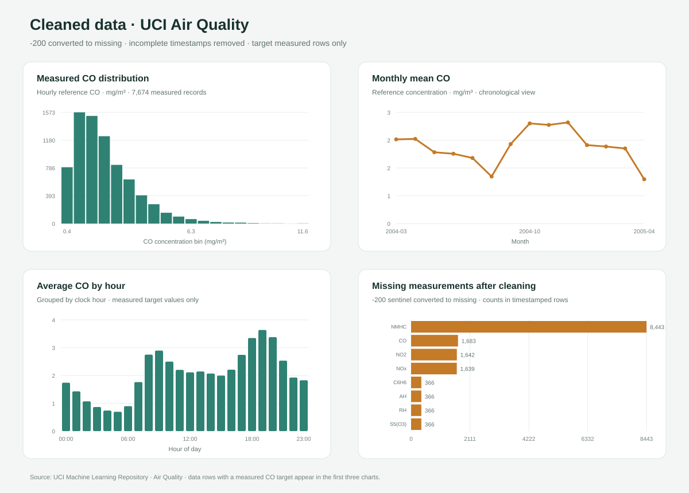

# AirSense — same-hour CO estimation

AirSense trains and demonstrates a regression model that estimates the reference analyzer's **same-hour carbon monoxide (CO) concentration, in mg/m³**, from five metal-oxide sensor responses, temperature, relative humidity, absolute humidity, and time features. It uses the historical UCI Air Quality dataset.

This is a reproducible model-training project with a local Streamlit demonstration. It is not a next-hour forecast, a live air-monitoring service, or an official AQI or health-alert system.

## Selection-round rubric map

| Evaluation area | Evidence in this repository |
| --- | --- |
| Repository and README (10 marks) | This guide, a focused source tree, pinned scikit-learn version, Windows launch and training scripts, and `.gitignore` rules that keep the raw archive and virtual environment out of Git. |
| Data cleaning (40 marks) | `train_model.py`, `data_quality_summary.json`, `cleaned_missingness.csv`, and the **Data quality** tab record the cleaning rules and counts. |
| Graphs after cleaning (10 marks) | `cleaned_data_eda.svg` shows cleaned target distribution, hourly and monthly CO summaries, and feature correlations. The source tables are saved as CSV files. |
| Training, testing, and evaluation (40 marks) | `training_manifest.json`, validation and test metrics, prediction-level results, baseline comparison, and search histories document the chronological workflow and final held-out results. |

## Repository layout

```text
AirQualityProjectDemo/
├── app.py                          # Local Streamlit demo and project evidence tabs
├── train_model.py                  # Cleaning, feature creation, training, and evaluation
├── run_demo.bat                    # Create local environment and launch the app
├── train_model.bat                 # Rebuild artifacts from CSV, XLSX, or ZIP input
├── requirements.txt                # Runtime dependencies; scikit-learn pinned to 1.6.1
├── evs03_model_bundle.joblib       # Selected fitted pipeline and feature metadata
├── training_manifest.json          # Dataset, split, search, and result summary
├── data_quality_summary.json       # Cleaning counts and missing-value audit
├── cleaned_*.csv / cleaned_data_eda.svg  # Post-cleaning summaries and charts
├── evs03_validation_metrics.csv    # Candidate comparison on validation period
├── evs03_test_metrics.csv         # Selected model's final held-out metrics
├── evs03_test_comparison.csv      # Selected model against a mean baseline
├── evs03_test_predictions.csv     # Timestamped predictions and residuals
├── randomized_search_results.csv  # Extra Trees search results
└── bayesian_search_history.csv    # Ridge alpha search history
```

The original dataset and `.venv` are not part of the repository. The training scripts read a dataset supplied from your computer; `.gitignore` also excludes the common dataset filenames and local environment folders.

## Data cleaning and preparation

The supplied UCI archive contains 9,471 source rows. The cleaning script preserves the source `-200` missing-value marker long enough to count it, converts it to missing data, parses date and time, and applies the following documented rules:

| Check or action | Result |
| --- | ---: |
| Source rows | 9,471 |
| Rows without a usable timestamp removed | 114 |
| Duplicate timestamps removed | 0 |
| Rows with valid timestamps retained | 9,357 |
| CO target values recorded as `-200` and excluded from model fitting/scoring | 1,683 |
| Measured CO target values available | 7,674 |
| Empty trailing columns ignored | 2 (`Unnamed: 15`, `Unnamed: 16`) |
| Rows removed by an automatic outlier rule | 0 |

The retained time span is **2004-03-10 18:00 through 2005-04-04 14:00**. Missing sensor and weather inputs remain in the data and are median-imputed inside a scikit-learn pipeline. The imputer is fitted only on the training rows for each cross-validation fold, then on development data for the final fit; the held-out test period does not determine imputation values. Rows without a measured CO target cannot be used as supervised examples and are excluded from fitting and scoring.

The model uses the five sensor channels (`PT08.S1` through `PT08.S5`), `T`, `RH`, `AH`, and cyclical hour-of-day and weekday features. Other pollutant reference values are not model inputs. No automatic outlier trimming is applied because validated physical bounds were not specified; this avoids silently deleting unusual measurements.

The full per-column sentinel counts and cleaning decisions are in [`data_quality_summary.json`](data_quality_summary.json). Post-cleaning missingness and feature summaries are in [`cleaned_missingness.csv`](cleaned_missingness.csv) and [`cleaned_feature_summary.csv`](cleaned_feature_summary.csv).

## Graphs from the cleaned data

The figure below is generated by the training script from the timestamp-cleaned data. The three CO summaries use records with a measured target; the correlation panel summarizes the model features and target.



The chart data is available in `cleaned_co_distribution.csv`, `cleaned_co_by_hour.csv`, `cleaned_co_by_month.csv`, and `cleaned_correlation.csv` so the summaries can be inspected or replotted.

## Training, testing, and evaluation

The evaluation preserves time order to better match use on later readings:

1. After timestamp cleaning, source rows are divided chronologically into 70% training, 15% validation, and 15% test periods.
2. Four expanding-window `TimeSeriesSplit` folds are used on training rows for model search and cross-validation. Imputation stays inside each model pipeline.
3. Candidate models are compared on validation data. The selected model is **Extra Trees with randomized hyperparameter search**. A Ridge alpha search and an expanding-window Ridge/Extra Trees stack are also recorded as secondary comparisons; the stack's base hyperparameters were selected on the full training partition before its OOF meta-model fit, so it is not a fully nested stack. Neither secondary comparison is the packaged model.
4. The selected pipeline is refit on the combined training and validation periods, then evaluated once on the later held-out test period. There are 1,374 measured test examples from **2005-02-05 03:00 to 2005-04-04 14:00**.

### Held-out test results

| Model | R² | MAE (mg/m³) | RMSE (mg/m³) | Within ±0.5 mg/m³ | Within ±1.0 mg/m³ |
| --- | ---: | ---: | ---: | ---: | ---: |
| Extra Trees (selected) | 0.7831 | 0.3549 | 0.6127 | 80.35% | 90.76% |
| Development-mean baseline | -0.0276 | 1.0642 | 1.3336 | 25.18% | 51.75% |

The baseline predicts the mean CO measured in development data for every test row. Lower MAE and RMSE are better; higher R² is better. “Within ±0.5” and “within ±1.0” are tolerance-based shares of test predictions, not generic classification accuracy. Validation scores, which informed model selection, are separate from these final test scores. See `evs03_test_metrics.csv`, `evs03_test_comparison.csv`, and `evs03_test_predictions.csv` for the recorded values and individual residuals.

The full split boundaries, row counts, search descriptions, and selected-model metrics are recorded in [`training_manifest.json`](training_manifest.json). `evs03_validation_metrics.csv`, `randomized_search_results.csv`, and `bayesian_search_history.csv` provide supporting selection evidence.

## Run the demo on Windows

1. Install Python 3.11.
2. Keep the project files together and double-click `run_demo.bat`.
3. On first launch, the script creates `.venv`, installs `requirements.txt`, and starts the Streamlit app in your browser.

The app includes same-hour estimate, data-quality, cleaned-data, model-evaluation, and method views. Missing sensor inputs are accepted and handled by the fitted training pipeline. The displayed alert limit is an editable demonstration setting, not a regulatory or health threshold.

## Rebuild the model

Download the UCI Air Quality data archive and extract it locally if desired. Keep the raw file outside Git. In File Explorer, drag the CSV, XLSX, or ZIP archive onto `train_model.bat`, or open a terminal in this folder and run:

```powershell
train_model.bat "C:\path\to\archive.zip"
```

The batch script creates `.venv` if needed, installs the listed dependencies, and writes the cleaned-data summaries, charts, fitted bundle, manifest, search records, and evaluation outputs into this folder. For repeatable model loading, `requirements.txt` pins scikit-learn to **1.6.1**, the version used to serialize the current bundle.

## Limitations and data terms

- This estimates same-hour CO from historical sensor-array readings; it does not forecast future hours or provide live measurements.
- The output is not an AQI calculation, regulatory measurement, or medical/public-health advice. Sensor-derived estimates can be wrong and should not be used as official warnings.
- The dataset covers one historical deployment and period. Performance on other sensors, locations, or time periods is not established by this evaluation.
- The UCI dataset page lists **CC BY 4.0** metadata, while its description also states that commercial use is excluded. Because those statements conflict, treat the data conservatively as research-only and verify the current terms with the dataset provider before any commercial reuse. Retain the dataset attribution and citation.

## Dataset citation

De Vito, S., Massera, E., Piga, M., Martinotto, L., & Di Francia, G. (2008). *On field calibration of an electronic nose for benzene estimation in an urban pollution monitoring scenario*. Sensors and Actuators B: Chemical, 129(2), 750–757. UCI Machine Learning Repository, [Air Quality dataset](https://archive.ics.uci.edu/dataset/360/air+quality), DOI: [10.24432/C59K5F](https://doi.org/10.24432/C59K5F).
